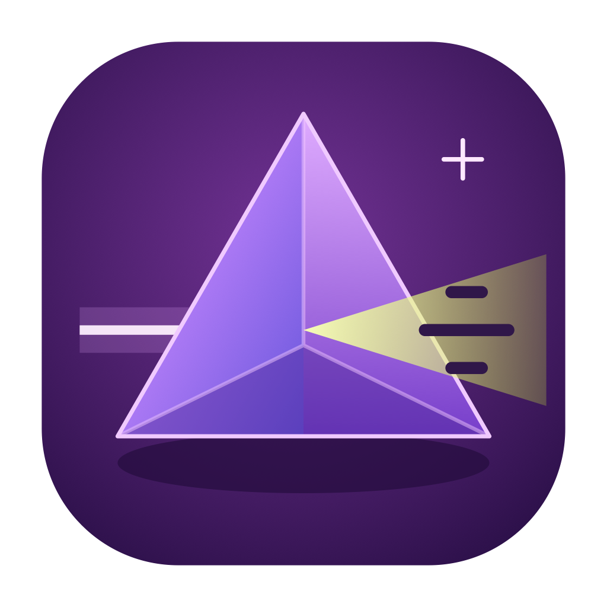

<p align="center"></p>

# LaTeXShot

Screenshot an equation and copy it as LaTeX, offline.

[Download for Mac](https://github.com/exploringtruth/latexshot/releases/latest/download/LaTeXShot.dmg) · [Website](https://exploringtruth.github.io/latexshot/) · [Feedback](https://github.com/exploringtruth/latexshot/issues)

**v1.0.0** is available for Apple silicon. The frozen printed-equation benchmark accepted 60 of 66 results (90.9%), below the 95% target. Review the copied LaTeX before using it. [Benchmark results](benchmarks/pix2text-v1/README.md)

## Install

Requires an **Apple silicon Mac (M1 or later) running macOS 14 or later**. The first release targets printed equations in PDFs and websites; handwriting is planned for a follow-up release.

Open the official DMG, drag **LaTeXShot** to **Applications**, then open LaTeXShot from Applications. The app is **ad-hoc signed and unnotarized**. The [v1.0.0 ZIP](https://github.com/exploringtruth/latexshot/releases/download/v1.0.0/LaTeXShot-1.0.0.zip) is an alternative download. Verify either file against the published [SHA256SUMS](https://github.com/exploringtruth/latexshot/releases/download/v1.0.0/SHA256SUMS).

### If macOS blocks the app

1. Download the DMG from this repository's official [GitHub releases](https://github.com/exploringtruth/latexshot/releases).
2. Open the DMG and move **LaTeXShot** to **Applications**.
3. Open LaTeXShot from Applications once. macOS may block it because the developer or notarization cannot be verified.
4. If you trust this download, open **System Settings → Privacy & Security**, scroll to the security message for LaTeXShot, and click **Open Anyway**.
5. Click **Open** in the confirmation prompt. See [Apple's instructions](https://support.apple.com/en-us/102445).

Grant Screen Recording access when prompted so LaTeXShot can read the equation you select. The app lives in the menu bar. Open **Settings → General** to control Launch at Login.

## Capture and shortcuts

Press **⌘⇧L**, drag around a printed equation, then paste its LaTeX. **Escape** cancels selection. **Capture Equation** in the menu uses the same capture flow. Change, clear, or restore the shortcut in **Settings → Shortcuts**.

Clipboard formats in **Settings → General**:

| Format | Example |
| --- | --- |
| Raw LaTeX (default) | `x^2` |
| Inline Markdown | `$x^2$` |
| Display Markdown | `$$x^2$$` |
| Inline LaTeX | `\(x^2\)` |
| Display LaTeX | `\[x^2\]` |
| Custom | Your literal prefix + `x^2` + suffix |

Custom wrappers preserve spaces and line breaks, including empty fields. The copied popup displays the equation body independently of the selected wrapper. A recognition failure preserves the previous clipboard.

## Equation History

Choose **Equation History** from the menu bar menu to open a panel at the top center of the current display. Click a rendered equation to copy it in the current clipboard format, or drag it into a compatible text field. LaTeXShot keeps the 10 most recently copied equations by default. In **Settings → General**, pause recording or choose a limit from 1 to 5,000. Assign an optional **Show Equation History** shortcut in **Settings → Shortcuts**. Use the trash button in the panel to clear the history.

Changing the clipboard format immediately recopies the latest LaTeXShot equation when one is available.

## Updates

Download updates manually from [GitHub Releases](https://github.com/exploringtruth/latexshot/releases). Quit LaTeXShot and replace the app in Applications with the newer copy. In-app update checks and automatic updates are disabled in v1.0.0.

## Privacy

Equation crops stay in memory during capture and recognition. Recognition uses a bundled offline model and runtime; it does not upload crops. Preferences, including clipboard format, custom wrappers, shortcut, and first-run hint state, are stored locally. Launch at Login is managed by macOS.

Equation History stores recent copied formula text on your Mac across restarts.

Screen Recording permission allows the app to capture the selected screen region. **Send Feedback…** opens GitHub Issues in your default browser; you choose what to submit. No analytics are configured. A local development run may need separate model/runtime setup; see [recognition packaging](docs/UPDATER.md#offline-recognition-assets).

## Feedback

Use **Send Feedback…** from the menu or [open a GitHub issue](https://github.com/exploringtruth/latexshot/issues). Include the macOS version and what happened. Share an equation or screenshot only when you intend to make it public.

## Build locally

Use an Apple silicon Mac with macOS 14 or later and **Swift 6.2 / Xcode 26 or later**. A development recognition environment also requires Python 3.12. Prepare the pinned [Pix2Text runtime and model](docs/runtime/pix2text.md), then run:

```sh
python3 scripts/build-pix2text-runtime.py /absolute/path/to/latexshot-development
LATEXSHOT_ALLOW_PIX2TEXT_TRIAL=1 \
LATEXSHOT_RECOGNITION_PYTHON=/absolute/path/to/latexshot-development/RecognitionRuntime/bin/python3 \
LATEXSHOT_MODEL_DIRECTORY=/absolute/path/to/latexshot-development/RecognitionModel \
swift run LaTeXShot
```

The setup command downloads the pinned development dependencies and model and needs a network connection. Recognition after setup runs offline. This development environment is not proof that a runtime can be relocated inside a distributed app.

The app-side recognition adapter requires the offline runtime and model from the recognition track. A local package can be built without them for menu, Settings, and permission smoke checks; equation recognition remains unavailable until those assets are provided:

```sh
VERSION=1.0.0 bash scripts/build-dmg.sh --local
```

Output: `.build/dist/--local/1.0.0/LaTeXShot.app`, a versioned DMG, stable-name DMG, and ZIP. Approved artwork is optional for this local smoke build. This is not a public release qualification.

Maintainers: [update setup, release gates, and rollback](docs/UPDATER.md). Product requirements and benchmark targets are in [PLAN.md](PLAN.md).
